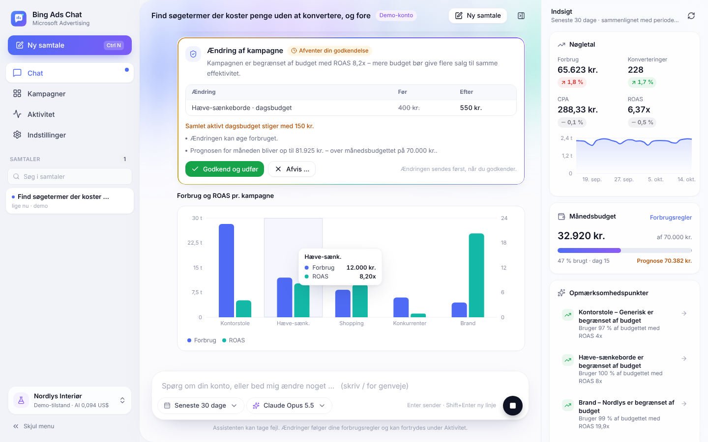

# Bing Ads Chat

En lokal **Windows-desktopapp**, hvor du styrer din **Microsoft Advertising (Bing Ads)**-konto ved at chatte med en
AI-assistent (Claude). Assistenten kan analysere, rapportere og ændre kontoen – men altid inden for de
**forbrugsregler**, du selv sætter, og med **godkendelse** og **fortryd** på ændringerne.

Bygget i samme stil og med samme teknologi som Inventarland-dashboardet: **Tauri 2** (native Windows-vindue) +
**React 19 / TypeScript / Tailwind 4**, animationer med **motion** og komponenter i **React Bits**-stil.



## Hvad kan den?

**Chatten** (hovedvisningen)
- Streamede svar med markdown, tabeller og en sammenklappelig "tankegang".
- Værktøjstrin vises som en tidslinje, der kan foldes ud (fx *Henter kampagner · 8 kampagner* med datatabel).
- Grafer, nøgletal og tabeller direkte i chatten (`show_chart`, `show_kpis`, `show_table`).
- **Godkendelseskort** for ændringer: før → efter, begrundelse, hvilke forbrugsregler der gælder, Godkend/Afvis (med
  kommentar til assistenten) og **Fortryd** bagefter.
- Slash-kommandoer (`/overblik`, `/spild`, `/budget`, `/fordeling`, `/annonce`, `/søgeord`, `/rapport`, `/forbrug`,
  `/ændringer`), forslag på startskærmen, periode- og modelvælger i chatfeltet.
- Samtalehistorik med søgning, omdøb og slet. Genveje: `Ctrl+N` ny samtale, `Ctrl+K` fokus på chatfeltet, `Ctrl+,` indstillinger.

**Assistentens værktøjer (Microsoft Advertising API v13)**

| Læse | Ændre |
| --- | --- |
| Konti, kampagner, annoncegrupper, søgeord, annoncer, negative søgeord | Kampagner: status, dagsbudget, navn, budstrategi (Manuel/Forbedret CPC, Maks. klik/konverteringer, Mål-CPA, Mål-ROAS …) |
| Overblik med sammenligning mod forrige periode | Opret / slet kampagner og annoncegrupper |
| Rapporter: konto, kampagne, annoncegruppe, søgeord, **søgetermer**, annonce, geografi, enhed, alder/køn, time, ugedag | Søgeord: tilføj, bud, pause, slet |
| Søgeordsidéer og budgetanbefalinger (Ad Insight) | Negative søgeord på kampagne/annoncegruppe |
| Forbrug denne måned + prognose | Responsive søgeannoncer: opret, pause/aktivér |
| Ændringsloggen | **Alt andet** via et generelt REST v13-værktøj (udvidelser, målretning, målgrupper, konverteringsmål …) – kræver altid godkendelse |

**Forbrug (Indstillinger → Forbrug)**
- Godkendelsestilstand: *Godkend alt* · *Godkend forbrugsøgninger* (anbefalet) · *Autopilot inden for grænser*.
- Månedsbudget med prognose, advarsel ved X % og **budgetvagt**, der kan pause alt ved 100 %.
- Hårde grænser: maks. dagsbudget pr. kampagne, maks. samlet dagsbudget, maks. CPC-bud, tilladt at oprette/slette,
  nye kampagner starter pauset, **beskyttede kampagner** som assistenten ikke må røre.
- Budgetstigninger over X % kræver altid godkendelse (også i autopilot).
- **Nødstop**: pause alle kampagner med ét klik (kan fortrydes).

**Øvrigt**
- Indsigtspanel ved chatten: nøgletal, trend, månedsbudget og automatiske *opmærksomhedspunkter* (budgetbegrænsede
  kampagner, høj CPA, forbrug uden konverteringer …) – klik for at få assistenten til at analysere dem.
- Kampagneside med inline-redigering af budget og status og "Spørg AI" pr. kampagne.
- Aktivitetslog over alle ændringer (assistent, dig, budgetvagt) med fortryd.
- AI-indstillinger: model (Opus 5.5 anbefalet, Sonnet 5.5, Haiku 5.5, Fable 5.1), indsats, vis tankegang,
  **månedligt AI-budget** og forbrugsoversigt i USD/DKK.
- Virksomhedsprofil (mål-CPA/ROAS, dækningsgrad, tone of voice, egne instruktioner), som assistenten bruger.
- **Demo-konto** ("Nordlys Interiør") med realistiske, deterministiske data – hele appen kan prøves uden Microsoft-login.

## Kom i gang

Forudsætninger (de samme som til Inventarland): **Node.js 20+**, **pnpm 10**, **Rust (stable-msvc)**,
**Visual Studio 2022 Build Tools** med "Desktop development with C++" og **WebView2** (følger med Windows 10/11).
Se evt. [Tauri prerequisites](https://v2.tauri.app/start/prerequisites/#windows).

```bash
pnpm install
pnpm app:dev      # åbner appen i et native vindue (hot reload)
```

Byg en installer (`.msi` og `setup.exe` i `src-tauri/target/release/bundle/`):

```bash
pnpm app:build
```

Første gang du åbner appen, guider en velkomst dig igennem: Claude-nøgle → Microsoft Advertising (eller demo) → forbrugsregler.

### Claude API-nøgle
Opret en nøgle på [console.anthropic.com](https://console.anthropic.com/settings/keys) og indsæt den under
*Indstillinger → Forbindelser*. Den gemmes i **Windows Credential Manager**.

### Microsoft Advertising
1. Hent dit **developer token** i Microsoft Advertising under *Værktøjer → Developer Portal* (kræver Super Admin).
2. Opret en **app-registrering** i [Microsoft Entra ID](https://portal.azure.com) → *App-registreringer → Ny registrering*
   ("Accounts in any organizational directory and personal Microsoft accounts").
3. Under *Authentication*: tilføj platformen **Mobile and desktop applications** med redirect-URI `http://localhost`,
   og slå **Allow public client flows** til.
4. Indsæt developer token og **Application (client) ID** i appen og klik **Log ind med Microsoft**. Browseren åbner,
   du logger ind, og appen henter dine konti.

Login bruger OAuth 2.0 med PKCE og en midlertidig lokal port; refresh-tokenet gemmes i Windows Credential Manager og
fornys automatisk.

## Kommandoer

| Kommando | Formål |
| --- | --- |
| `pnpm app:dev` | Desktop-app i udviklingstilstand |
| `pnpm app:build` | Byg Windows-installere |
| `pnpm dev` | Kun UI i browseren (Microsoft-kald går via en lille dev-proxy; nøgler gemmes i localStorage – kun til udvikling) |
| `pnpm check` | TypeScript + tests |
| `pnpm app:icons` | Generér ikoner fra `src-tauri/icons/app-icon.svg` |

## Arkitektur

```
src/
  ai/            agent-løkke (streaming + værktøjer), systemprompt, forbrugsregler (guardrails), værktøjer, modelpriser
  bing/          Microsoft Advertising: OAuth, REST v13-klient, live-backend, rapporter, demo-konto
  components/    reactbits/ (Aurora, Orb, BlurText, SpotlightCard, ClickSpark, CountUp, ElasticSlider, Stepper …),
                 ui/ (knapper, felter, dropdowns, dialoger), blocks/ (KPI'er, grafer, tabeller), layout/
  features/      chat, insights, campaigns, activity, settings, onboarding
  stores/        zustand: indstillinger, forbindelse, samtaler (IndexedDB), aktivitetslog, AI-forbrug
src-tauri/       Rust-skal: sikker nøglelagring (Credential Manager), OAuth-loopback, HTTP-scope til Microsoft
```

- **Sikkerhed:** Webdelen kan kun kalde Microsofts domæner via Tauri HTTP-pluginnet (scope i
  `src-tauri/capabilities/default.json`) og Claude via CSP. Nøgler gemmes kun i Windows Credential Manager.
  Indhold fra kontoen (kampagnenavne, søgetermer, API-svar) behandles som data, ikke instruktioner.
- **Hver ændring** bliver til en *ChangePlan*, der vurderes af `src/ai/guardrails.ts` (bloker / kræv godkendelse /
  tillad) før noget sendes til Microsoft, og logges med en fortryd-operation.
- **Claude:** Messages API med streaming, adaptive thinking, effort, prompt caching og server-side fallback.
  Historikken er append-only, så cache og tankeblokke forbliver gyldige.
